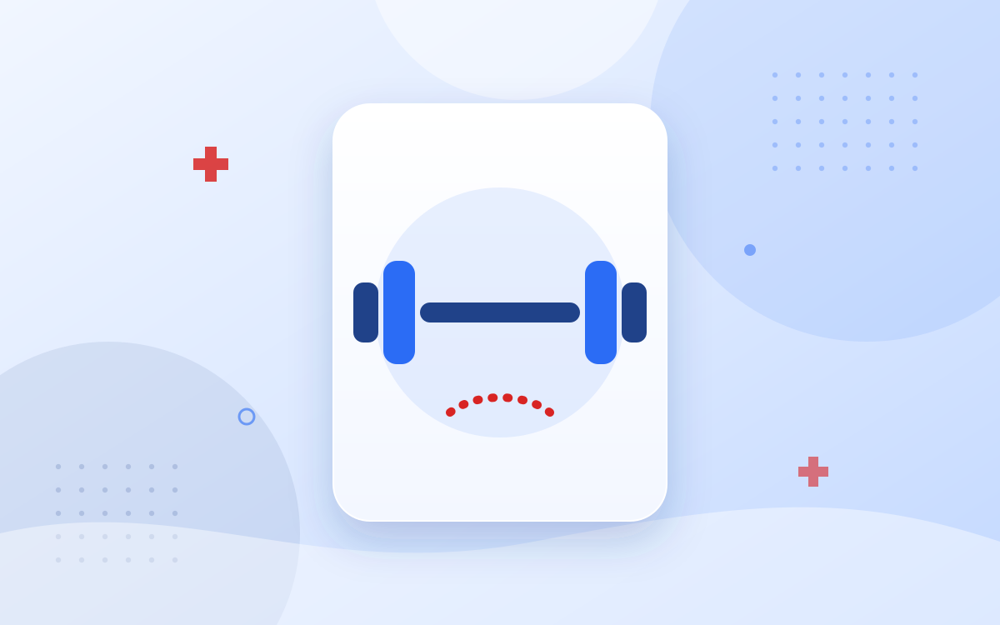

## Adjustment Diets

To control the weight, patients need to reduce the **caloric intake** to a level lower than the caloric consumption. This asks for food adjustments without causing food shortage. Less calories does not always mean less quantities of food.
The composition of the food is the most important thing. That is why patients need to see a dietician.

## Physical Exercise

Also the **consumption of calories** is very important. This can be stimulated by physical exercises. An exercise from minimum 30 minutes a day (on top of your daily activities) and a moderate intensity. For example, walking, swimming, running.

## Medication

The medication reduces the absorption of fat. Different studies show that medication used for obesity, results in a very little weight loss.

